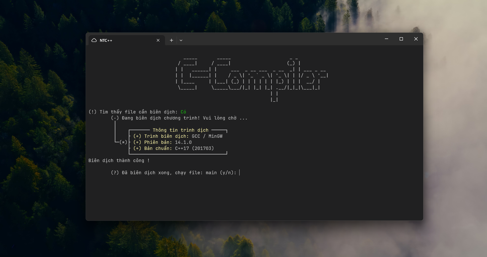

# C-compiler

Chương trình này là công cụ biên dịch nhiều file.cpp trong thư mục `src`, biên dịch nhanh và tiện lợi không cần phải nhớ lệnh hay gõ tay nhiều lần. Công cụ này giống như Makefile nhưng nó cơ bản và dễ dùng hơn. Tiện cho người chưa tiếp xúc với Makefile. Công cụ có những điểm hay như cho biết thông tin trình dịch, nếu file có thay đổi mới biên dịch còn không thay đổi thì cho chạy thẳng file thực thi, không biên dịch lại tránh mất thời gian 



## Cách sử dụng 

Biên dịch `C-compiler.cpp` thành `C-compiler.exe`
Sau đó đưa file `C-compiler.exe` đến dự án muốn biên dịch 
File c_compiler phải nằm theo kiến trúc file như sau 

```txt
Project
    ├── src/
    │   ├── lib/
    │   │   ├── module1.h
    │   │   └── module2.h
    │   ├── file1.cpp
    │   ├── file2.cpp
    │   └── main.cpp 
    └── C-compiler.exe
```  

Sau khi biên dịch sẽ cho ra file main.exe trong thư mục bin (chương trình chính của dự án)

```txt
Project
    ├── bin/
    │   └── main.exe
    ├── src/
    │   ├── lib/
    │   │   ├── module1.h
    │   │   └── module2.h
    │   ├── file1.cpp
    │   ├── file2.cpp
    │   └── main.cpp 
    └── C-compiler.exe
```

> Lưu ý: phải đưa tất cả file muốn build vào folder `src` và file C_compiler.exe phải nằm ngoài folder `src`

---

## Biên dịch và dùng 

```bash
git clone https://github.com/trgchinhh/C-compiler.git
cd C-compiler/
g++ ./C-compiler.cpp -o ./C-compiler
```

Sau đó lấy file C-compiler đã biên dịch được bỏ vào dự án mà bạn muốn biên dịch và dùng 

---

## Tác giả 
**Nguyễn Trường Chinh (NTC++)**<br>
**Ủng hộ:** [Nếu bạn thấy hữu ích hãy ủng hộ mình](https://github.com/sponsors/trgchinhh)<br>
**GitHub:** [https://github.com/trgchinhh](https://github.com/trgchinhh)

---

> 📌 Dự án nhỏ được phát triển với mục đích học tập và nghiên cứu. Mọi góp ý và đóng góp đều được hoan nghênh. Nếu thấy hữu ích thì cho mình xin 1 sao cho repo này !!!